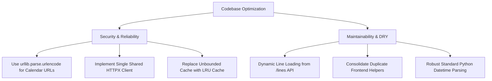

# Codebase Audit Report: RATP Calendrier Travaux

This document presents a comprehensive audit of the **RATP Calendrier Travaux** application from the perspective of a **Senior Software Developer**, **Data Architect**, and **Cybersecurity Agent**.

---

## Executive Summary

The project is built as a split stack:
- **Backend**: A FastAPI (Python) service that proxies Navitia/IDFM PRIM API data, filters and normalizes transit disruptions, and formats them into ICS files and Google Calendar events.
- **Frontend**: A Next.js (TypeScript) client with a responsive dashboard, interactive map/itinerary view, and calendar visualization (FullCalendar).

### Overall Assessment
- **Architecture**: **B+** — Strong separation of concerns. Adheres to Domain-Driven Design (DDD) with clear boundaries (`domain`, `services`, `api`).
- **Comprehensibility**: **A-** — Code is clean, well-commented, type-hinted, and easy to read.
- **Maintainability**: **B-** — There is significant configuration duplication between backend and frontend (such as line colors, names, and logos).
- **Reliability & Performance**: **C+** — The service creates a new HTTP connection pool for every external API request and relies on a simplistic, unbounded in-memory cache which poses a risk of memory exhaustion.
- **Security**: **B** — Generally secure CORS and non-root Docker configurations. However, manual URL encoding in calendar URL generation creates potential injection risks.

---

## 1. Security Audit

> [!WARNING]
> ### 1.1 Unsafe Google Calendar URL Building (High Risk)
> In `src/services/ics_generator.py` at `build_google_calendar_url`, the URL is built manually using basic string replacement operations:
> ```python
> title = summary.replace(" ", "+").replace("—", "-")
> ...
> safe_desc = description[:400].replace(" ", "+").replace("&", "%26")
> url += f"&details={safe_desc}"
> ```
> This manual encoding is highly fragile. Special characters (such as `?`, `#`, `=`, `/`, `@`, and emojis/non-ASCII characters) are not properly escaped. This can corrupt the query string or cause **Query Parameter Injection**.
> * **Mitigation**: Use Python's standard `urllib.parse.urlencode` to construct query parameters safely and robustly.

### 1.2 CORS & API Key Exposure (Low Risk)
- **Positive**: CORS is restricted to configurable origins loaded from `.env` (`ALLOWED_ORIGINS`). This is a best-practice configuration that prevents wildcard `*` vulnerabilities in production.
- **Positive**: The Navitia API key (`NAVITIA_API_KEY`) is stored entirely on the server and is never exposed to the client. The frontend proxies all its requests through the FastAPI backend.

### 1.3 Denial of Service & Rate Limiting (Medium Risk)
- **Finding**: FastAPI endpoints do not implement rate-limiting or request sanitization. The `/places?q=<query>` endpoint accepts any user-supplied query string and forwards it to the external PRIM API. Although cached, an attacker could send high-frequency randomized queries to exhaust the Navitia PRIM API quota or crash the server.

---

## 2. Reliability Audit

> [!IMPORTANT]
> ### 2.1 Inefficient HTTP Client Lifecycle (Socket Exhaustion)
> In `src/services/navitia_client.py`, every single function instantiates a new `httpx.AsyncClient` as a context manager:
> ```python
> async with httpx.AsyncClient(timeout=12.0) as client:
>     resp = await client.get(url, headers={"apikey": api_key})
> ```
> Instantiating a new client on every request creates and destroys connection pools. This introduces substantial latency due to repeated TCP/TLS handshakes and can trigger **Socket Exhaustion** (running out of ephemeral ports) under moderate concurrency.
> * **Mitigation**: Use a shared `httpx.AsyncClient` instance reuse connection pools across requests.

### 2.2 Unbounded In-Memory Cache (Memory Exhaustion)
- **Finding**: The caching mechanism in `navitia_client.py` uses simple Python dictionaries (`_line_reports_cache`, `_places_cache`, `_journeys_cache`). While keys are bypassed if expired, old keys are **never evicted**.
- **Impact**: Under continuous operation or exposure to automated scanner queries, the dictionaries will grow indefinitely, resulting in a **memory leak** and eventual Out-Of-Memory (OOM) termination by the container orchestrator.
- **Mitigation**: Use a proper cache structure with eviction strategies (e.g. Least Recently Used - LRU) or a robust library like `cachetools` / `aiocache`.

### 2.3 Fragile Date Parsing
- **Finding**: In `src/domain/disruptions.py`, `_navitia_dt_to_iso` relies on manual string slicing and indexing to parse dates:
  ```python
  date_part = date_part.replace("-", "")[:8]
  time_part = time_part.split(".")[0].replace(":", "")[:6]
  return f"{date_part[0:4]}-{date_part[4:6]}..."
  ```
  If Navitia shifts its format or includes a timezone suffix, this manual indexing can fail silently, producing malformed date-times or throwing `IndexError` at runtime.
- **Mitigation**: Use Python's standard `datetime` formatting library to parse and serialize ISO formats.

---

## 3. Maintainability Audit

> [!IMPORTANT]
> ### 3.1 Hardcoded Configuration Duplication (SSOT Violation)
> The metadata for all Paris transit lines is hardcoded twice across two different languages:
> 1. **Backend**: `src/domain/lines.py` (`LINE_REGISTRY`)
> 2. **Frontend**: `frontend/lib/lines.ts` (`LINE_COLORS`, `LINE_LOGOS`, `LINE_GROUPS`)
>
> This layout violates the **Single Source of Truth (SSOT)** rule. Adding a line or updating colors requires modifications in both Python and TypeScript files.
> * **Mitigation**: Fetch all line metadata dynamically from the backend's `/lines` endpoint on the frontend. This eliminates the duplicate configuration inside `frontend/lib/lines.ts` entirely.

### 3.2 Code Duplication on Frontend
- **Finding**: The helper functions `causeLabel` and `effectLabel` are duplicated verbatim between `frontend/app/page.tsx` and `frontend/components/DisruptionCard.tsx`.
- **Mitigation**: Extract these helpers into a single utility file (e.g., `frontend/lib/utils.ts` or `frontend/lib/api.ts`).

---

## 4. Comprehensibility Audit

- **Positive**: The codebase is very clean and easy to follow. High-quality type hints are present across both python and typescript.
- **Positive**: File naming, folder structure, and division of labor (FastAPI routing, domain validation, external client, React UI) follow industry-standard patterns.
- **Positive**: Next.js state management is straightforward, and FullCalendar integration is lightweight and clean.

---

## Summary of Key Recommendations


